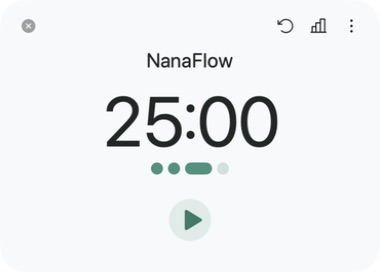
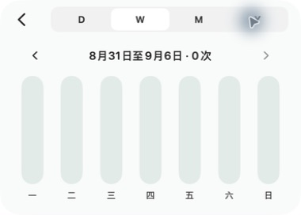

# NanaFlow

NanaFlow 是一个本地优先的原生 macOS 专注计时器。它用紧凑的单窗口体验帮助你开始专注、完成休息，并通过 D/W/M/Y 统计看清自己的节奏。倒计时与统计在同一个主窗口内切换，菜单栏随时提供状态和控制；用于统计的会话数据保存在本机。

## 下载与版本状态

[在 Mac App Store 免费下载](https://apps.apple.com/cn/app/nanaflow/id6814738160) · [官网](https://nana-fox.github.io/) · [使用帮助](https://nana-fox.github.io/support/)

2026-11-02 已核实：**1.0.1（4）已通过审核并自动发布**，中国区和美国区公开商店均显示 1.0.1。适用于 macOS 15 或更高版本，无需注册账号。维护者的官方商店实际下载安装核对仍单独记录，不以页面上架替代。

1.0.1 包含窗口外缘与拖动、菜单本地化及版本显示改进，统计可切换专注次数与净专注时长，专注与休息可分别选择完成声音，并改进通知调度。下方功能范围以 Mac App Store 版为准；正式更新通过商店提供。[GitHub 公测版](https://github.com/nana-fox/NanaFlow/releases/tag/v1.0-beta.1) 是单独的测试渠道。

## 界面

| 专注计时 | 周统计 |
| --- | --- |
|  |  |

## 当前范围

- 25/5/30 默认周期、暂停、继续、跳过、重置与自动开始。
- 主窗口内统计：日、周、月、年视图；柱形支持悬浮查看数值，日视图遵循本地日期和夏令时边界。
- 本机保存会话数据并用于日、周、月、年统计。当前商店版没有进入历史列表或备份/导入的界面入口。
- 设置、通知、应用内快捷键与自动化；随包包含 Widget 扩展，当前更新的实际宿主画面与刷新仍待复核。
- 状态栏倒计时及快速命令；可显示 `25:00 | 3`，不显示品牌半圆标记。
- 手动「跳到专注 / 跳到休息」立即开始下一阶段；自然结束仍遵循自动开始设置。
- 商店版不包含网页阻断器、洞察、标签、迷你计时器和付费墙。

## 菜单栏与阶段跳转

在「设置 → 菜单栏」开启「显示今日完成数」后，菜单栏显示 `倒计时 | 数量`，不额外显示“今日”。开关默认关闭，修改立即生效并在重启后保留；当天尚无已完成专注时显示 `0`。

数量按本地日期和会话结束时间统计，仅包括已完成的专注，不包括休息与中途跳过；与当天统计采用相同口径。日期区间采用左闭右开边界，午夜结束的会话只计入新的一天。

菜单栏、主窗口按钮及菜单和全屏休息界面中的主动跳转，会从下一阶段的完整时长立即开始。运行、暂停、尚未开始时都适用；强制专注期间仍不能跳过。自然结束以及 URL / AppleScript / App Intents 的既有跳转命令继续遵循自动开始偏好。

设计、实现范围和验收边界见 [菜单栏今日完成数与跳转即开始](Plans/menu-bar-daily-count-and-skip-start.md)。

## 工程结构

| 路径 | 内容 |
| --- | --- |
| `Sources/NanaFocus` | 主应用、计时器、窗口与系统集成 |
| `Sources/NanaShared` | 主应用与 Widget 共用模型 |
| `Sources/NanaFlowWidget` | Widget extension |
| `Tests/NanaFocusTests` | 单元、契约与视图回归测试 |
| `Design/nanaflow-ui-prototype` | 可运行的视觉交互原型 |
| `project.yml` | XcodeGen 工程定义 |

## 本地开发

要求：macOS 15 或更高版本，支持 Swift 6 和 macOS 26 SDK 的 Xcode（控制中心 Widget 使用 macOS 26 API，主应用最低运行版本仍为 macOS 15），以及 [XcodeGen](https://github.com/yonaskolb/XcodeGen)。

```sh
git clone https://github.com/nana-fox/NanaFlow.git
cd NanaFlow
```

```sh
xcodegen generate
xcodebuild test -project NanaFlow.xcodeproj -scheme NanaFlow -destination 'platform=macOS'
```

日常构建并启动当前源码版本：

```sh
./script/build_and_run.sh
```

使用 `--verify` 可在启动后确认进程存活；`--debug`、`--logs` 和 `--telemetry` 分别用于 LLDB、进程日志与应用子系统日志。Codex 项目的 Run 动作已连接到同一脚本。

这个脚本会退出当前所有同名 NanaFlow 进程并启动开发构建，`--verify` 也会如此。请先保护当前计时与数据；需要不打扰日常使用时，不运行这个脚本或 Codex Run 动作。进程存活也不能代替功能验收。

无需开发者证书的静态分析：

```sh
xcodebuild analyze \
  -project NanaFlow.xcodeproj \
  -scheme NanaFlow \
  -configuration Release \
  -destination 'generic/platform=macOS' \
  CODE_SIGNING_ALLOWED=NO
```

视觉原型：

```sh
cd Design/nanaflow-ui-prototype
npm ci
npm run build
npm run test:sites
```

## 仅构建本地候选

无需发行证书的构建可用于检查编译结果；它不能证明正式沙盒、App Group、Widget 或商店下载验收通过。下面的命令只构建，不启动应用：

```sh
xcodebuild build \
  -project NanaFlow.xcodeproj \
  -scheme NanaFlow \
  -configuration Release \
  -destination 'generic/platform=macOS' \
  -derivedDataPath ./DerivedData \
  CODE_SIGNING_ALLOWED=NO

```

## 发布状态

NanaFlow 1.0.1（4）已通过审核并于 2026-11-02 自动发布，Apple 后台精确构建显示“可分发”，中国区和美国区公开版本均为 1.0.1。官方商店下载变体的实际获取核对仍待完成。

本次更新的 186 项产品检查与 1 项后台隔离检查、Release 分析和签名归档通过，Apple 已处理并验证上传二进制。本机使用同一归档的签名 Release 候选完成首启、退出重开与可见计时／统计／设置保留验收；没有将其当作 TestFlight 下载变体。通知动作、Widget 像素刷新和实际提示音仍待后续验收。

发布范围、数据迁移和门禁见 [`Plans/mac-app-store-release.md`](Plans/mac-app-store-release.md)。代码审查见 [`CODE_AUDIT.md`](CODE_AUDIT.md)，第三方资源说明见 [`THIRD_PARTY_NOTICES.md`](THIRD_PARTY_NOTICES.md)。

## 维护与下一步

[维护交接](Plans/project-maintenance.md) 汇总渠道区别、目录保留规则、已知踩坑和下次的有限清单。商店文案及当前审核记录统一放在 [AppStore](AppStore/README.md)；旧规划的历史步骤不再作为当前待办。

## 许可

本仓库尚未选择开源许可证。在许可证明确前，代码的复制、修改和分发权限不作额外授权。
